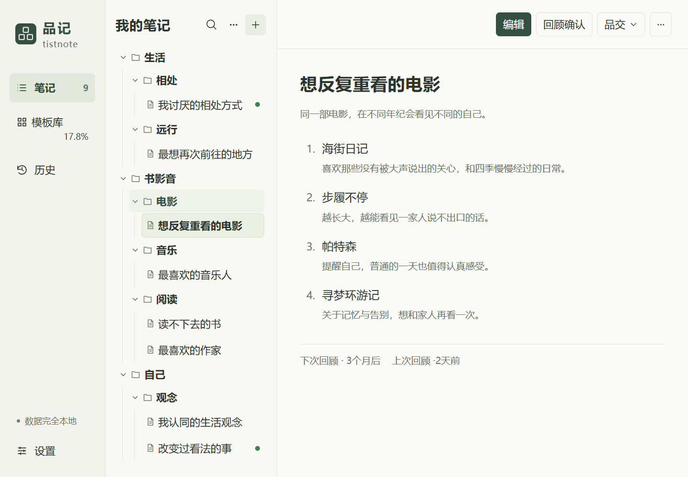
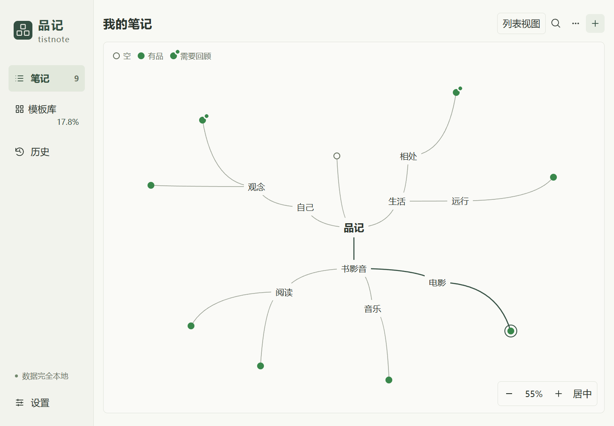
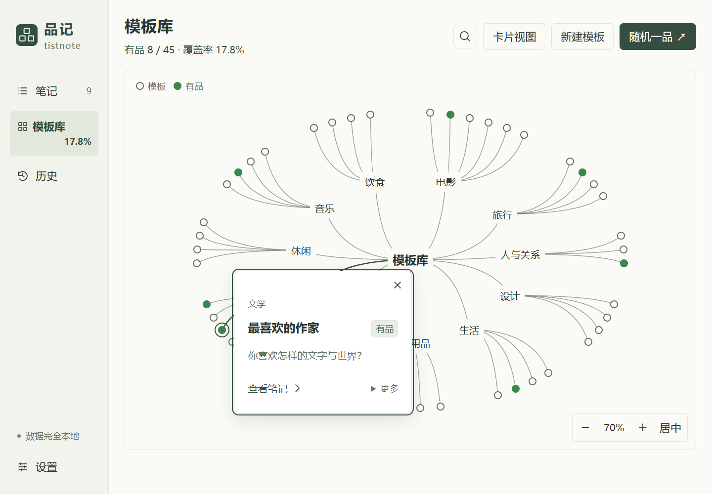
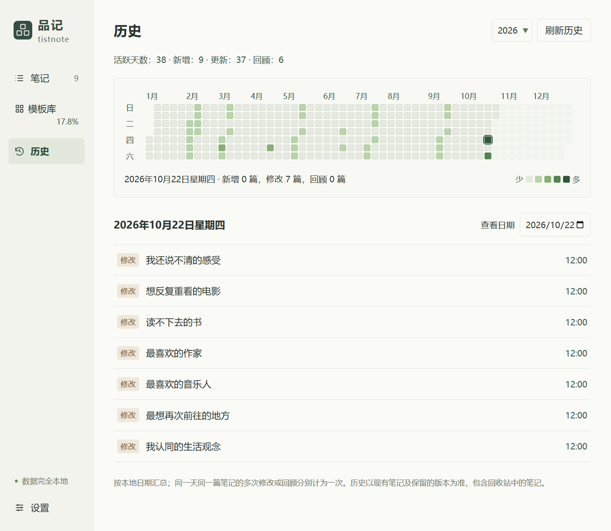

# 品记 · tistnote

[English](README.md) · [打开网页版](https://leoatopos.github.io/tistnote/) · [下载 Windows 版](https://github.com/LeoAtopos/tistnote/releases/latest)

**品察世间，记录好恶。**

品记是一款以本地文件保存数据的列表笔记应用，提供 Windows 版、安卓版本和 GitHub Pages 网页版，用来记录个人审美与偏好，品察世间万物与人生百态。

喜欢与讨厌、认同与反感，以及复杂和尚未说清的感受，都可以成为一份记录。写下自己的感受与缘由，回看审美与偏好的变化，也通过分享增进彼此理解。



以下为应用实际截图，笔记内容和使用历史均为虚构范例，用来展示喜欢、不喜欢和未定的感受，不包含个人使用数据。

品记适合为自己留出半小时、一小时或更久，沉下心来回顾经历、比较取舍、仔细斟酌着书写；也适合在生活发生重要事情、产生强烈感受后，郑重打开旧品单，重读并正式修订。时间由你决定，自动保存保护过程，完成本次书写后可以私藏、重读或选择分享。设计方向与验收要求见[产品需求文档](docs/PRD.md)。

## 下载 Windows 版

在 [GitHub Releases](https://github.com/LeoAtopos/tistnote/releases/latest) 下载最新 Windows 10/11 x64 构建：

| 文件 | 使用方式 |
| --- | --- |
| [tistnote-0.2.0-windows-x64-setup.exe](https://github.com/LeoAtopos/tistnote/releases/download/v0.2.0/tistnote-0.2.0-windows-x64-setup.exe) | 完整离线安装包，包含 WebView2 运行时，适合首次安装 |
| [tistnote.exe](https://github.com/LeoAtopos/tistnote/releases/download/v0.2.0/tistnote.exe) | 直接运行，需要电脑已有 Microsoft WebView2 |

Release 同时提供使用说明、构建信息及 `SHA256SUMS.txt` 校验文件。仓库已公开，下载和应用使用均无需账号。

Windows 安装包下载链接保持不变，现有地址对应完整离线安装包。Windows 应用中不显示网页上的“安装 Windows 版本”入口。

## 下载安卓版本

[下载签名 APK](https://github.com/LeoAtopos/tistnote/releases/download/v0.2.0/tistnote-0.2.0-android.apk)。支持 Android 8.0 及以上、已启用并更新系统 WebView 的设备；通用 APK，不限 ARM 或 x86 架构。应用不申请联网权限，界面、插图和图片生成均在本机运行。

安装入口统一放在 **设置 → 安装本地版本** 中，提供 Windows 和安卓下载；当前已安装的平台不显示自身安装入口。

安卓资料库保存在应用私有目录，笔记、分组、历史、模板与回收站均为真实本地文件。通过系统文件选择器导出完整 ZIP 备份、恢复备份、导入 Markdown 和保存 PNG，也支持复制图片到安卓剪贴板。**卸载前务必导出完整备份，卸载会删除应用内资料库。**

安卓 ZIP 备份解压后，选择包含 `notes/` 和 `.tistnote/` 的文件夹，即可在 Windows 或网页版打开；Windows / 网页资料库也可完整压缩后导入安卓，必须保留 `.tistnote/`。恢复会新建资料库，不覆盖当前资料库。安卓 ZIP 恢复限制为压缩和解压后均不超过 256 MB，单文件不超过 64 MB。详细说明见[安卓版本文档](docs/ANDROID.md)。

## 使用网页版

[打开 GitHub Pages 网页版](https://leoatopos.github.io/tistnote/)。使用最新版桌面 Chrome 或 Edge，选择现有品记资料库或空文件夹并授予读写权限。笔记、分组、历史、模板和回收站保存在授权文件夹，使用与 Windows 版兼容的 Markdown 格式。浏览器会在权限允许时记住资料库，也可能要求重新授权。

网页从 GitHub Pages 加载程序资源，笔记不上传，没有账号、遥测或云同步。Windows 正式应用仍完全本地。网页版不是移动客户端，不支持本地文件接口的浏览器无法编辑资料库。

同一资料库请勿同时在 Windows 版和网页版中编辑。网页标签使用独占写入锁，但无法与桌面程序的系统文件锁互通。修订检查和恢复日志保护可检测的冲突及中断写入，请保留完整备份。网页分组移动要求其中为 UTF-8 文件，遇到不支持的内容会报错；完整备份可复制二进制文件。

构建网页版运行 `npm run build:pages`，将 `dist-pages/` 内容与 `.nojekyll` 发布到 `gh-pages` 分支根目录，在 GitHub Settings → Pages 中选择该分支。仅推送 `main` 不会自动更新部署。

## 可以记录什么

- 想反复重看的电影、读不下去的书、让我又爱又恨的作品。
- 喜欢的设计、不合口味的食物、不想再买的日用品。
- 欣赏的品质、讨厌的相处方式、不认同的观念。
- 改变过看法的事，或还说不清的感受。

每份笔记包含主题、可选说明、标签、条目和可选理由。支持有排名与无排名两种方式，顺序与表达由你决定。

## 主要功能

- **语言与外观**：界面支持中文和英文，首次按系统语言选择（中文系统显示中文，其余显示英文）；设置中可手动选择并保留偏好。外观支持浅色、深色及跟随系统，即时切换，不改变已有笔记内容。
- **六页介绍引导**：网页版首次访问即自动展示，桌面版首次打开本地品单时展示，之后可点击左上角品牌区重看。主题绿色品牌页、黑白人物线稿配一句话，支持滑动翻页，最后用点线动画演示品单的建立。
- **清晰浏览与编辑**：打开笔记默认浏览，点击“编辑”后填写内容；自动保存，完成编辑时可填写更新日志，也可留空提交。支持“取消编辑”，有更新时确认后恢复本次编辑前的内容与分组，不新增提交。
- **分组与笔记树**：分组对应真实文件夹，支持子分组、拖拽移动笔记和整个分组、展开折叠及键盘导航。列表右键可“新建笔记”“新建分组”：空白处建在根目录，分组内建在对应位置。
- **精简列表与查找**：默认只显示标题，空笔记标记“（空）”；支持详细展示、全文搜索、标签筛选和排序。
- **笔记画布**：在“我的笔记 → 更多 → 画布视图”切换，默认仍为列表。按分组层级展开，未分组笔记直连“品记”；空笔记为空心圈，有内容为实心绿圈，回顾到期额外显示小绿点。支持缩放、平移、搜索及点击打开笔记。
- **画布整理**：拖动笔记或整个分组调整位置，拖至其他分组中间会移动本地文件；拖至同级分组上沿或下沿调整排序，列表同步。在分组上右键可直接新建笔记或子分组。布局和分组顺序随资料库保存。
- **45 个内置主题**：涵盖正向、负向与复杂感受；支持“随机一品”、个人模板及从笔记提取不含答案的模板。
- **模板分支画布**：默认按“模板库 → 标签 → 模板”展开，支持拖拽平移、滚轮与双指缩放。空心圆表示模板，实心绿圆表示“有品”；悬浮显示主题，点击打开原模板卡片，点击空白关闭，也可切换回卡片视图。
- **模板覆盖率与直达笔记**：对应在用笔记已有有效条目时，模板显示“有品”；点击标题、标记或“查看笔记”可切换到对应笔记，多个匹配时打开最近更新的一篇。入口显示总覆盖率，同一模板不重复计数，筛选不改变统计范围；仍可从更多菜单“另写一份”。
- **两种历史视角**：单篇笔记可比较、恢复版本并添加里程碑；全局“历史”用年度活跃图分别展示每天新增、修改和回顾过的笔记。
- **回顾提醒与确认**：默认 3 个月未更新或确认的品单在列表显示绿点；浏览时可随时“回顾确认”，每次确认都会保留历史记录，编辑时可调整周期。回顾时间与周期保存在本地 Markdown 中。
- **品交：展品与求品**：点击“品交”展开两个选项；“展品”选择条目、理由及公开字段生成 PNG，“求品”生成不包含自己答案的邀请图片。默认导出一张完整长图，也可选择分页图片。两种图片都可填写署名，留空匿名，按具名或匿名使用不同文案；页脚均内置打开品记网页版的二维码。
- **资料库管理**：支持复制、Markdown 导入、完整备份与恢复。回收站位于设置中，永久删除前需确认。
- **数据保护**：标题在整个资料库内唯一；新建同名主题自动编号。外部修改、修订冲突和损坏文件会提示，保留可恢复的数据。

竖屏或窄屏打开有笔记的资料库时，先展示笔记列表；空资料库展示“从一次品察开始”引导。宽屏横向窗口保留列表与内容双栏。所有可阅读界面文字至少为 18 CSS px。

## 从品察到回顾

**看见笔记之间的结构。** 笔记画布按分组与子分组展开：空心圈表示空笔记，实心绿圈表示已有内容，右上角的小绿点提醒回顾。



**找到值得认真想一想的主题。** 模板库按标签展开，点击圆点打开模板卡片；已经有对应记录的主题会显示“有品”。



**回看自己的变化。** 历史界面汇总新增、更新和回顾确认，选择一天即可重新打开当时的笔记。



## 本地保存与隐私

正式应用的核心操作完全离线，无账号、服务器、遥测、云同步或联网更新。笔记以 Markdown 保存在自己选择的文件夹中，版本与模板也保存在同一资料库内。

```text
资料库/
├─ notes/
│  ├─ <笔记 UUID>.md
│  └─ <分组>/<子分组>/<笔记 UUID>.md
└─ .tistnote/
   ├─ manifest.json
   ├─ history/<笔记 UUID>/<版本 UUID>.json
   ├─ templates/<模板 UUID>.json
   ├─ trash/
   ├─ conflicts/
   └─ vault.lock
```

分组移动保留 Markdown 内容与版本历史。UUID 文件名用于避免 Windows 文件名限制，界面标题来自笔记正文。外部编辑时请保留元数据、条目标识和 `<!-- tistnote:entries -->` 分隔标记。

资料库未加密，请妥善保管备份。全局使用历史以现有笔记和保留版本为准；永久删除相应数据后不再计入历史。分享内容由你选择，生成图片后由你自行发送。

## 本地开发

技术栈：**Tauri 2 + Rust + React 19 + TypeScript + Vite**。

Windows 开发环境需要：

- Node.js 22.12 或更新版本。
- Rust MSVC 工具链。
- Visual Studio C++ Build Tools 和 Windows SDK。
- Microsoft WebView2。

安装依赖并启动桌面开发模式：

```powershell
npm ci
npm run desktop
```

也可使用显式的浏览器开发预览：

```powershell
npm run dev
```

打开 `http://127.0.0.1:1420/?preview=1`。该预览仅使用当前浏览器的本地存储，不能代替真实 Markdown 资料库；生产构建不包含此开发适配器。

## 构建 Windows 版本

```powershell
# 完整离线安装包：内置 WebView2 离线运行时
npm run package
```

- 可执行程序：`src-tauri/target/release/tistnote.exe`。
- NSIS 安装包：`src-tauri/target/release/bundle/nsis/`。
- 默认只构建完整离线安装包，`npm run package:offline` 保留为等效命令。

开发依赖和打包工具的首次下载需要网络，正式应用的核心功能不需要网络。目标平台为 Windows 10/11 x64；当前程序尚未代码签名，正式分发前应完成干净系统的安装与卸载验收。

## 验证

安卓构建需要 JDK 17+、Gradle 8.11.1、Android SDK platform/build-tools 35；设置 `JAVA_HOME`、`GRADLE_HOME`、`ANDROID_HOME` 后，在 Windows 上运行 `npm run package:android`。构建会执行安卓文件测试和 release lint，生成签名 APK。签名密钥及凭据保存在仓库外的 `%LOCALAPPDATA%/TistnoteBuild/signing/`，请妥善备份，以便后续版本保持签名一致，不要上传密钥或凭据。

```powershell
npm test
npm run build
cargo test --lib --manifest-path src-tauri/Cargo.toml
```

领域测试覆盖标题、分组、模板覆盖率、使用历史汇总、分享隐私及分页等规则。Rust 测试使用临时资料库验证文件读写、版本、备份、冲突与数据保护。

`scripts/qa-*.js` 是 Playwright CLI 流程验证片段，用于检查桌面与窄屏交互，不是正式应用的运行依赖。安装包、依赖目录、构建产物及测试输出不纳入源码仓库。

## 项目结构

| 目录 | 内容 |
| --- | --- |
| `src/` | React 界面、笔记模型、模板、图片分享及开发预览适配器 |
| `src-tauri/` | Rust 本地存储、桌面命令、权限与 Windows 打包配置 |
| `public/` | 本地图标等静态资源 |
| `tests/` | 前端领域测试 |
| `scripts/` | 浏览器流程验证片段 |
| `docs/` | 产品定义与验证记录 |

更多说明见 [产品需求文档](docs/PRD.md) 和 [验证记录](docs/VALIDATION.md)。

## 开源协议

本项目采用 [MIT 开源协议](LICENSE)。Copyright © 2026 LeoAtopos。
